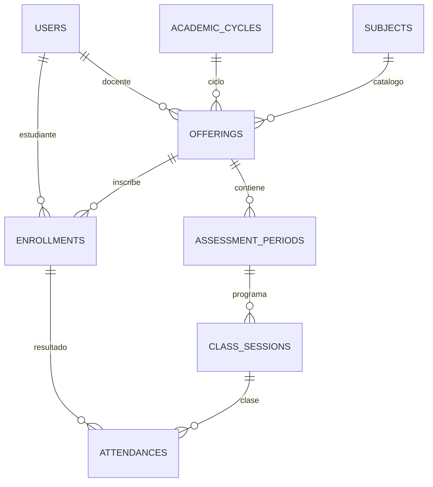

# Modelo de datos

Migraciones secuenciales del framework, cuatro migraciones originales de dominio y una nueva en v0.2.0.
Usar migraciones nuevas cuando
la versión inicial ya se haya compartido o tenga datos: no cambiar silenciosamente un esquema aplicado.

| Tabla | Propósito / restricción clave |
| --- | --- |
| users | Cuenta, rol, active, correo único (también lower(email)) y carné único opcional en BD/obligatorio en altas de estudiantes |
| academic_cycles | Ciclo; código único y fechas coherentes |
| subjects | Catálogo independiente; código único |
| offerings | Materia/ciclo/grupo único; docente y capacidad > 0 |
| enrollments | Estudiante/grupo único; vigencia conservada |
| assessment_periods | Cómputo único por oferta/número; versión de política |
| class_sessions | Clase; período del mismo grupo, fin > inicio y motivo al cancelar |
| attendance_portals | Ventana temporal y métodos permitidos; token solo como hash |
| reader_sessions | UUID, docente autenticado, portal y caducidad |
| nfc_credentials | Hash SHA-256 único, usuario, estado y vencimiento del alta pendiente |
| attendances | Un resultado por inscripción/sesión; ambos pertenecen a la misma oferta |
| absence_requests | Solicitud única por inscripción/sesión, mismo grupo, evidencia privada |
| attendance_events | UUID único, hash de solicitud, resultado y referencias de auditoría |
| report_versions | Versión única por cómputo, instantánea JSONB y PDF privado |
| news | Oferta o ciclo obligatorio, texto simple y autor |
| notifications | Estructura estándar de notificaciones de Laravel |
| audit_logs | Antes/después JSONB y motivo; sin contraseñas ni tokens en claro |
| sessions, password_reset_tokens, cache, cache_locks, jobs, job_batches, failed_jobs | Infraestructura del framework |

FKs compuestas: class_sessions(period_id, offering_id) → assessment_periods(id, offering_id).
attendances y absence_requests enlazan (enrollment_id, offering_id) y (session_id, offering_id).
Las tablas referenciadas tienen UNIQUE(id, offering_id). No se usa borrado en cascada para historial académico.

Las constraints **no verifican por sí solas** el rol del docente, cupos restantes, inscripción vigente,
ventana del portal, idempotencia por cuerpo, visibilidad de archivos o reglas del 75 %.
v0.2.0 valida roles de asignación, cupos y fechas académicas en Requests/Policies/Actions/Academic,
con locks ciclo → grupo → recurso y bitácora. La vigencia para registrar asistencia, ventana de portal,
credenciales e idempotencia se implementan en fase 2; cierre/cálculo/descargas privadas en fase 3.
En esta entrega no existen endpoints para escribir asistencias, credenciales, permisos o reportes.
