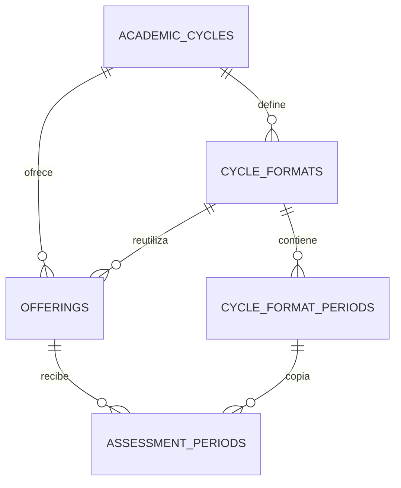

# Modelo de datos · v0.3.0

A04 sobre 0.3.2/A03 integrado: `2026_10_23_000100_add_offering_administrative_state` agrega
`offerings.active BOOLEAN NOT NULL DEFAULT TRUE` e índice `(cycle_id, active)`. No cambia fechas,
estados de ciclo/cómputos ni relaciones; ningún dato se copia para Historial. Rollback bloqueado si
hay grupos suspendidos o auditoría de transiciones A04. Desarrollo no migrado en esta revisión.
Todas las FKs académicas siguen RESTRICT. news también bloquea eliminar grupos. Auditoría guarda
referencias polimórficas y no se elimina junto al grupo. Cómputos iniciales heredados únicamente se
retiran dentro del borrado transaccional tras demostrar su vaciedad e igualdad con la auditoría original;
sesiones, inscripciones, asistencia, permisos/evidencias, portales/lectores/eventos y ReportVersion
nunca se eliminan por este flujo. [Contrato y operación](a04-group-management.md).

A03 sobre 0.3.2: migración incremental `2026_10_22_000100_add_academic_closures`.
Añade inicio real/finalización nullable a sesiones y CHECK unstarted; current_report_id/reopened_at/causas
de cierre a cómputos; closed_at/reopened_at/causas a ciclos. ReportVersion agrega generación/origen/hash;
actores de reportes y resultados pueden ser null para Sistema. PDF ya era nullable y sigue pendiente.
No rellena historia ni reconstruye desarrollo. Snapshot completo, inmutable y versionado; vigente por FK.
Registros cerrados sin snapshot válido se muestran inconsistentes; no se reconstruye su historia.
Rollback protegido cuando ya existen datos A03. [Contrato, privacidad y operación](a03-closures.md).
Las referencias inferiores a ReportVersion reservado o cierre pendiente describen el esquema anterior.

A02 sobre 0.3.2 añade la migración `2026_10_21_000100_add_portal_geographic_access`:
`class_sessions.event_attendance_mode` nullable con restricción in_person/online para eventos;
`attendance_portals.access_modality` y `geo_reference` nullable; `attendance_events.geo_validation`
nullable sin coordenadas del estudiante. No se reclasifican registros ni se escriben resultados A01.
Referencia privada y evidencia mínima se retiran a los 30 días mediante `attendance:prune-location`;
UUID/hash/respuesta permanecen para idempotencia. [Contrato y actualización](a02-geographic-access.md).

A01 sobre v0.3.2 conserva este esquema, sin migraciones nuevas. `assessment_periods.policy_version`
recibe project-2026-v1 en cómputos nuevos. Se normalizaron explícitamente 2 cómputos de desarrollo;
la operación excluye cierres y cualquier ReportVersion, audita con actor_id null y conserva fechas/datos.
La definición inmutable está en código y se devuelve en el contrato de cálculo. ReportVersion sigue reservado para A03/B02.
La consulta de A01 toma locks compartidos ciclo → grupo → cómputo y no escribe resultados.

Migraciones incrementales; se conservan las originales y la de v0.2.0. Fase 2 agrega dos migraciones
2026_10_14 (UTC): años/formatos y contrato de eventos/unicidad NFC. No se edita un esquema compartido.

| Tabla | Propósito / restricción clave |
| --- | --- |
| users | Rol/active, correo/carné únicos; entry_year nullable 1900–2200 y study_year nullable 1–10 |
| academic_cycles | Ciclo, código único y fechas coherentes |
| cycle_formats | Nombre por ciclo/versión, disponibilidad; fecha usada no se modifica desde acciones |
| cycle_format_periods | Cómputos del formato, número único y fechas; sin superposición en acción |
| subjects | Catálogo independiente, código único |
| offerings | Materia/ciclo/grupo único, docente/cupo; formato opcional del mismo ciclo |
| assessment_periods | Cómputo por grupo/número, fechas/política/estado; origen format_period_id opcional |
| enrollments | Estudiante/grupo único, vigencia inclusiva conservada |
| class_sessions | Clase/estado, período del mismo grupo, fin > inicio, motivo para cancelación |
| attendance_portals | Ventana/métodos, token solo hash |
| reader_sessions | UUID propio de docente/portal y caducidad |
| nfc_credentials | Hash SHA-256 único, pending/active/revoked; índice parcial una activa por usuario |
| attendances | Un resultado inscripción/sesión, ambos pertenecen al mismo grupo |
| absence_requests | Solicitud única inscripción/sesión del mismo grupo; evidencia privada |
| attendance_events | UUID global, actor/hash canónico, session_id, response JSONB, http_status y referencias |
| notifications | Avisos internos estándar Laravel por propietario |
| audit_logs | Actor/acción/antes/después/motivo, whitelist sin secretos/rutas privadas |
| report_versions | Cierres A03 con snapshots inmutables, origen/actor/generación/hash y versión única por cómputo; PDF pendiente |
| news | Preparación para noticias de fase 3; sin flujo operativo todavía |
| sessions, password_reset_tokens, cache, cache_locks, jobs, job_batches, failed_jobs | Infraestructura Laravel |

La FK compuesta offerings(cycle_format_id, cycle_id) → cycle_formats(id, cycle_id) impide elegir
un formato de otro ciclo. Copiar crea filas independientes de AssessmentPeriod: cerrar un grupo
no cierra el cómputo de otros grupos. Relaciones de origen preservan trazabilidad; usados no se editan.
Usuarios/grupos anteriores quedan sin años/formato y conservan fechas/historial/contraseñas.

FKs compuestas de base: class_sessions(period_id, offering_id) → assessment_periods(id, offering_id).
Attendances y absence_requests enlazan enrollment_id/oferta y session_id/oferta a claves únicas compuestas.
La aplicación no ofrece borrado de historial ni reportes/evidencias desde public/storage.

SQL no valida por sí solo rol, cupo, calendario sin solapamiento, vigencia, ventana, cuerpo idempotente,
archivo privado ni política del porcentaje. Policies/Requests/Actions aplican esas reglas en fase 1–2.
Orden de bloqueo: ciclo → grupo → cómputo/sesión → recurso; registro añade primero advisory lock global
por UUID normalizado. Los eventos guardan resultados seguros, nunca el token; índice/locks no sustituyen
pruebas de procesos independientes con PostgreSQL nativo.

Las gráficas existentes agrupan consultas autorizadas, sin generar datos. A01 incorpora cálculo
vivo mediante AttendanceSummary; A03 añade consulta cerrada/histórica desde snapshot y reapertura. PDF pendiente de B02.
AssessmentPeriod.policy_version solo se cambia en desarrollo mediante la operación explícita autorizada,
no desde una consulta ni como un alias de versiones desconocidas.
