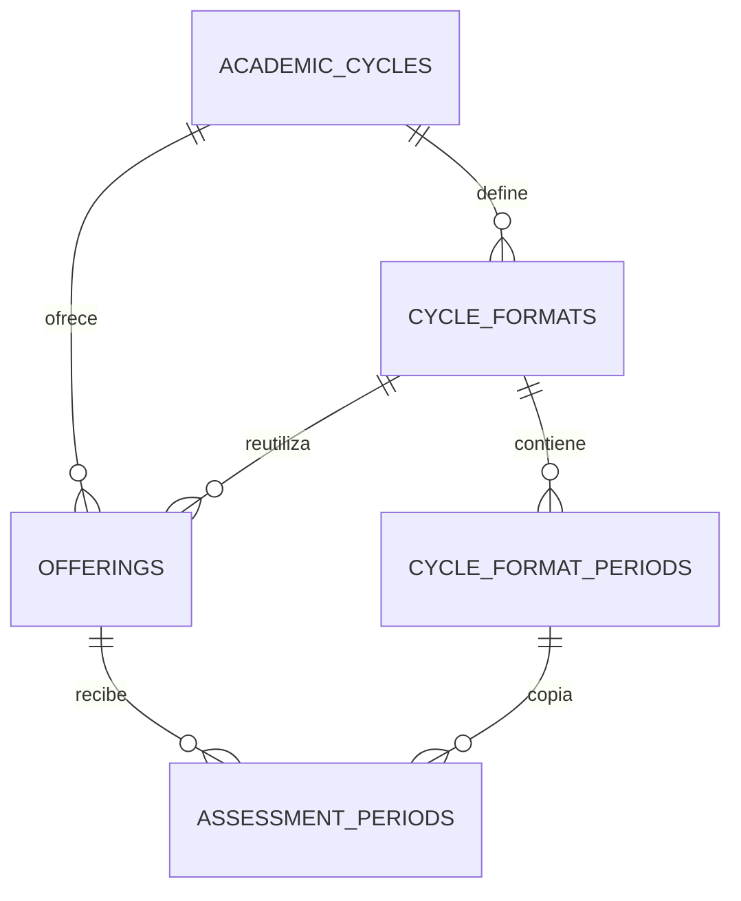

# Modelo de datos · v0.3.0

Migraciones incrementales; se conservan las originales y la de v0.2.0. Fase 2 agrega dos migraciones
2026_10_14 (UTC): años/formatos y contrato de eventos/unicidad NFC. No se edita un esquema compartido.

| Tabla | Propósito / restricción clave |
| --- | --- |
| users | Rol/active, correo/carné únicos; entry_year nullable 1900–2200 y study_year nullable 1–10 |
| academic_cycles | Ciclo, código único y fechas coherentes |
| cycle_formats | Nombre por ciclo/versión, disponibilidad; fecha usada no se modifica desde acciones |
| cycle_format_periods | Cómputos del formato, número único y fechas; sin superposición en acción |
| subjects | Catálogo independiente, código único |
| offerings | Materia/ciclo/grupo único, docente/cupo; formato opcional del mismo ciclo |
| assessment_periods | Cómputo por grupo/número, fechas/política/estado; origen format_period_id opcional |
| enrollments | Estudiante/grupo único, vigencia inclusiva conservada |
| class_sessions | Clase/estado, período del mismo grupo, fin > inicio, motivo para cancelación |
| attendance_portals | Ventana/métodos, token solo hash |
| reader_sessions | UUID propio de docente/portal y caducidad |
| nfc_credentials | Hash SHA-256 único, pending/active/revoked; índice parcial una activa por usuario |
| attendances | Un resultado inscripción/sesión, ambos pertenecen al mismo grupo |
| absence_requests | Solicitud única inscripción/sesión del mismo grupo; evidencia privada |
| attendance_events | UUID global, actor/hash canónico, session_id, response JSONB, http_status y referencias |
| notifications | Avisos internos estándar Laravel por propietario |
| audit_logs | Actor/acción/antes/después/motivo, whitelist sin secretos/rutas privadas |
| report_versions / news | Preparación para cierre/PDF/versiones y noticias de fase 3, sin flujo operativo todavía |
| sessions, password_reset_tokens, cache, cache_locks, jobs, job_batches, failed_jobs | Infraestructura Laravel |

La FK compuesta offerings(cycle_format_id, cycle_id) → cycle_formats(id, cycle_id) impide elegir
un formato de otro ciclo. Copiar crea filas independientes de AssessmentPeriod: cerrar un grupo
no cierra el cómputo de otros grupos. Relaciones de origen preservan trazabilidad; usados no se editan.
Usuarios/grupos anteriores quedan sin años/formato y conservan fechas/historial/contraseñas.

FKs compuestas de base: class_sessions(period_id, offering_id) → assessment_periods(id, offering_id).
Attendances y absence_requests enlazan enrollment_id/oferta y session_id/oferta a claves únicas compuestas.
La aplicación no ofrece borrado de historial ni reportes/evidencias desde public/storage.

SQL no valida por sí solo rol, cupo, calendario sin solapamiento, vigencia, ventana, cuerpo idempotente,
archivo privado ni política del porcentaje. Policies/Requests/Actions aplican esas reglas en fase 1–2.
Orden de bloqueo: ciclo → grupo → cómputo/sesión → recurso; registro añade primero advisory lock global
por UUID normalizado. Los eventos guardan resultados seguros, nunca el token; índice/locks no sustituyen
pruebas de procesos independientes con PostgreSQL nativo.

Las gráficas agrupan consultas autorizadas, sin generar datos. Fase 3 diseñará cálculo aprobado,
cierre/snapshot/PDF y reapertura; AssessmentPeriod.policy_version conserva la propuesta demo actual.
